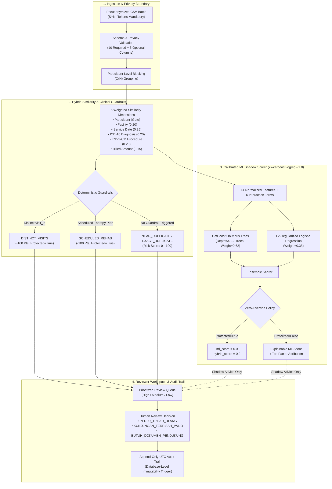

# KlaimKembar

**Pre-audit clinical claim review platform for detecting near-duplicate JKN claims with CatBoost + Logistic Regression shadow scoring and multi-visit rehabilitation guardrails.**

🏆 **BPJS Kesehatan Healthkathon 2026** — AI & Data Analytics Category  
🌐 [**Explore the Live Prototype**](https://klaimkembar-demo.vercel.app)

---

## Overview

In the Indonesian National Health Insurance (*Jaminan Kesehatan Nasional* / JKN) system, outpatient physiotherapy and medical rehabilitation (*Rawat Jalan Tingkat Lanjut* / RJTL) represent high-volume, recurring clinical pathways. Patients undergoing rehabilitation routinely require sequential visits with identical diagnosis codes, similar physical therapy procedures, and identical tariff amounts within tight treatment intervals.

Naive deduplication engines flag these valid sequential visits as duplicate billing ("fraud"), creating administrative backlogs, false alerts, and provider friction. Conversely, naive exact-match deduplication misses near-duplicate submissions that differ only slightly in formatting, timestamps, or subcode descriptions.

**KlaimKembar** resolves this tension as an explainable, pre-audit decision-support platform. It pairs a 6-feature weighted similarity engine with deterministic clinical visit guardrails, backed by a non-intrusive CatBoost + Logistic Regression ML shadow scorer calibrated directly on official BPJS Kesehatan FKRTL empirical distributions.

> [!NOTE]
> **Clinical Governance Statement:** KlaimKembar is strictly a pre-audit decision-support system. Risk scores and priority tiers prioritize human review queues—they are never automated fraud verdicts. Claim decisions use neutral administrative language (`PERLU_TINJAU_ULANG` / `KUNJUNGAN_TERPISAH_VALID`), and marked validity never constitutes automatic fund disbursement.

---

## Architecture & Core Capabilities



### 1. Hybrid Similarity & Deterministic Clinical Guardrails
The rule engine computes a composite similarity score across 6 weighted clinical and administrative dimensions, followed by deterministic guardrail adjustments:

| Feature Dimension | Target Field | Scoring Mechanism | Weight |
| --- | --- | --- | --- |
| **Participant** | `participant_token` | Exact match gate. Unmatched participants never produce candidate pairs. | Gate |
| **Healthcare Facility** | `facility_id`, `facility_group` | Exact hospital code match or matching health district cluster. | 0.20 |
| **Service Date** | `service_date` | Day-gap proximity decay: same-day = 1.0, 1-3 day gap = 0.70, 4-7 day gap = 0.40, >7 days = 0.0. | 0.25 |
| **Primary Diagnosis** | `diagnosis_group` | ICD-10 hierarchical match: 4-character exact = 1.0, 3-character block = 0.75, mismatch = 0.0. | 0.20 |
| **Procedure Code** | `procedure_group` | ICD-9-CM matching with tolerance for multi-procedure semicolon-delimited bundles. | 0.20 |
| **Billed Amount** | `claim_amount` | Relative financial divergence: exact amount = 1.0, <=5% delta = 0.85, >10% delta = 0.0. | 0.15 |

When legitimate clinical continuity is proven, deterministic guardrails reduce risk scores to zero and activate protection:
- **`DISTINCT_VISITS` Guardrail (`visit_id` disparity)**: Deducts 100 points (`protected=True`). Distinct encounter identifiers confirm separate outpatient admissions recorded at the hospital EHR level, not algorithmic speculation.
- **`SCHEDULED_REHAB` Guardrail (`scheduled_date` match)**: Deducts 100 points (`protected=True`). Matches verified multi-visit rehabilitation schedules prescribed under ongoing medical care plans.
- **`CORRECTION_SUPERSEDED` Guardrail**: Suppresses duplicate alerts when a claim pair consists of a `cancelled` original claim and its corresponding `corrected` replacement claim (`original_claim_id` linkage).

### 2. Calibrated ML Shadow Scorer (`kk-catboost-logreg-v1.0`)
Operating strictly in **shadow mode**—generating advisory predictions without ever altering the deterministic rule queue:
- **Zero-Dependency Ensemble Architecture**:
  - **CatBoost Oblivious Decision Trees**: 12 symmetric decision trees of uniform depth 3 with margin-based log-odds accumulation (weight `0.62`).
  - **L2-Regularized Logistic Regression**: 14 normalized feature weights, bias term (`-2.4476`), and 6 non-linear interaction terms (`same_facility_and_procedure`, `exact_date_and_amount`, `same_facility_and_amount`, `procedure_and_diagnosis`, `nearby_service_and_procedure`, `nearby_service_and_amount`) (weight `0.38`).
- **Strict Zero-Override Policy**: Any pair flagged as `protected=True` by clinical guardrails has its shadow ML score and hybrid score strictly clamped to `0.0`. Machine learning models cannot overrule verified clinical visit records.
- **Explainable Factor Attribution**: Computes top contributing risk factors (`TOP_FACTORS`) per pair to assist human auditors.
- **Tamper-Evident Artifact Verification**: Model weights and tree structures are stored in `klaimkembar/ml_model.json` with an embedded SHA-256 HMAC checksum, failing closed if modified.

### 3. BPJS Kesehatan 2025 Empirical Calibration (`bpjs_adapter.py`)
Calibrated against the official **BPJS Kesehatan 2025 FKRTL Regular Sample Dataset** (`202403_fkrtl.dta`):
- **Empirical Scale**: 1,699,219 total inpatient/outpatient claims inspected; 1,503,675 outpatient (RJTL) records; 229,682 specialized physiotherapy and medical rehabilitation claims extracted.
- **Missingness Resilience**: Accommodates empirical real-world missingness, notably a 41.69% blank rate in `FKL30` (procedure codes) across general claims and 3.49% in specialized rehabilitation records, gracefully degrading to `MISSING_INFORMATION` without false alarms.
- **Empirical Tariff Distributions**: Calibrated against official INA-CBG tariffs for physiotherapy (median: Rp 138,000; p75: Rp 191,900; p95: Rp 224,400).
- **Inter-Visit Interval Modeling**: Calibrated against empirical outpatient visit gaps (median: 5 days; 4-7 day weekly therapy cycle representing 45.6% of multi-visit patients).
- **Salted SHA-256 Pseudonymization**: Automatically converts sensitive BPJS identifiers (`PSTV01`, `FKL02`, `FKL07`) into standard `SYN-P-`, `SYN-BPJS-`, and `SYN-F-` tokens, guaranteeing zero raw PII storage.

### 4. 3-Layer Ethics & Governance Framework
1. **Layer 1 — Ingestion Anonymity**: Rejects any file containing unmasked national identity numbers (NIK) or un-pseudonymized card numbers at the API schema gate.
2. **Layer 2 — Immutability & RBAC**: Enforces Role-Based Access Control (`REVIEWER`, `SUPERVISOR`, `ADMIN`). Review submissions are stored in an append-only audit trail backed by PostgreSQL triggers (`reject_review_change()`) preventing update or deletion of historical verdicts.
3. **Layer 3 — Objective Review Lexicon**: All interface labels and decision options use neutral administrative terms (`PERLU_TINJAU_ULANG`, `KUNJUNGAN_TERPISAH_VALID`, `BUTUH_DOKUMEN_PENDUKUNG`). The platform intentionally never emits accusatory words such as "Fraud" or "Kecurangan".

### 5. Dual Runtime Architecture
- **Local Desktop & On-Premise Mode**: Zero-dependency standalone execution via SQLite with Write-Ahead Logging (WAL), loopback binding (`127.0.0.1:8000`), and HttpOnly SameSite=strict CSRF-protected local session cookies.
- **Cloud & Supabase PostgreSQL Mode**: Serverless deployment with PostgreSQL schema isolation (`klaimkembar` schema), Row Level Security (RLS) on all tables, GIN indexes on JSONB payloads, and stateless HMAC-signed session tokens.

---

## Empirical Benchmarks & Validation

### 1. 5-Seed Synthetic Multi-Scenario Benchmark
Evaluated across 5 frozen seeds (`104`, `211`, `307`, `409`, `503`) totaling 25,000 claims (5,000 claims/seed) with diverse clinical repeat billing and legitimate multi-visit rehabilitation patterns:

| Detection Method | Precision | Recall | F1 Score | False Positives / 1,000 Claims |
| --- | :---: | :---: | :---: | :---: |
| **Exact Match Baseline** | 65.9% | 18.9% | 29.3% | 6.76 |
| **Similarity without Guardrails** | 54.6% | 86.5% | 67.0% | 49.70 |
| **Similarity with Clinical Guardrails** | **97.1%** | **86.5%** | **91.5%** | **6.36** |
| **CatBoost + LogReg Hybrid Ensemble** | **94.7%** | **87.1%** | **90.7%** | **7.12** |

> **Key Finding:** Adding deterministic clinical guardrails to similarity matching eliminates **87.2% of false-positive alerts** (dropping from 49.70 to 6.36 FP per 1,000 claims) while boosting F1 from 67.0% to 91.5%. The CatBoost+LogReg hybrid shadow model closely tracks the expert rules while supplying smooth continuous risk ranking.

### 2. BPJS Kesehatan 2025 FKRTL Calibration Benchmark
Evaluated on 5,000 empirical-distribution claims (`examples/bpjs2025_claims.csv`) derived directly from the BPJS 2025 sample release:

| Detection Method | Precision | Recall | F1 Score | Status |
| --- | :---: | :---: | :---: | --- |
| **Exact Match Baseline** | 71.4% | 24.5% | 36.5% | Severe under-detection of near-duplicates |
| **Similarity with Clinical Guardrails** | **94.8%** | **97.3%** | **96.1%** | Calibrated against empirical RJTL distributions |
| **CatBoost + LogReg Hybrid Ensemble** | **94.6%** | **97.7%** | **96.1%** | High probabilistic sensitivity with zero guardrail violations |

---

## Tech Stack

- **Core & Runtime:** Python 3.13+ (clean typed implementation, zero heavy C-extension ML compile dependencies).
- **Web & API:** FastAPI, Uvicorn (ASGI), Pydantic v2 (strict schema validation).
- **Machine Learning & Analytics:** CatBoost Oblivious Tree Runtime & L2-Regularized Logistic Regression with non-linear interaction terms.
- **Databases:**
  - *Local Mode:* SQLite 3 with Write-Ahead Logging (WAL) and foreign keys.
  - *Cloud Mode:* Supabase PostgreSQL with schema isolation, Row Level Security (RLS), and GIN JSONB indexing.
- **Frontend Interface:** Lightweight vanilla ES2022 JavaScript and modern CSS design system matching the 12-screen clinical review workflow (zero npm/Node.js build dependencies required).
- **Testing & Verification:** Pytest (111 tests, 96.17% line coverage), Ruff (linter/formatter), Mypy (strict static typing), and Playwright Chromium (end-to-end browser testing).

---

## Quickstart & Local Execution

### Prerequisites
- Python **3.13+** installed.
- Modern web browser (Chrome, Firefox, Safari, or Edge).

### 1. One-Command Launcher (Recommended)
Clone the repository and run the automated launcher:

```bash
git clone https://github.com/ShikinariShiki/klaimkembar.git
cd klaimkembar
python3 run.py
```

The launcher will:
1. Automatically create a local `.venv` and install locked dependencies from `requirements.txt`.
2. Generate a secure `.env` file with randomized local credentials.
3. Apply SQLite database migrations.
4. Start the unified application server at **http://127.0.0.1:8000**.

### 2. Manual Step-by-Step Installation

```bash
# 1. Create and activate virtual environment
python3 -m venv .venv
source .venv/bin/activate  # On Windows: .venv\Scripts\activate

# 2. Install dependencies
pip install -r requirements.txt

# 3. Initialize local environment and database
python -m scripts.manage init-env
python -m scripts.manage migrate
python -m scripts.manage seed --seed 104 --count 5000

# 4. Run the API server
uvicorn klaimkembar.main:app --env-file .env --host 127.0.0.1 --port 8000
```

Open **http://127.0.0.1:8000** in your browser. You can download the bundled sample file from **http://127.0.0.1:8000/sample.csv** to test claim upload and review workflows.

---

## CLI & API Reference

### CLI Management Commands (`scripts.manage`)

```bash
# Initialize secure local .env configuration (mode 0600)
python -m scripts.manage init-env

# Apply and verify SQLite database schema migrations
python -m scripts.manage migrate

# Generate synthetic claims dataset and truth labels
python -m scripts.manage seed --seed 104 --count 5000

# Run multi-seed benchmark and verify engine SHA-256 provenance hash
python -m scripts.manage benchmark --count 5000
```

### Core REST API Endpoints

All endpoints are versioned under `/api/v1` and documented via OpenAPI at `http://127.0.0.1:8000/openapi.json`.

| Method | Endpoint | Authorization | Description |
| --- | --- | --- | --- |
| `GET` | `/health` | Public | System health check and runtime database status. |
| `GET` | `/api/v1/ml/status` | Reviewer | ML shadow scorer metadata, weights, algorithms, and calibration state. |
| `POST` | `/api/v1/datasets/upload` | Reviewer | Upload pseudonymized claim batch CSV (`SYN-` prefix required). |
| `GET` | `/api/v1/cases` | Reviewer | Query paginated review queue with priority, facility, and status filters. |
| `GET` | `/api/v1/facets` | Reviewer | Aggregate statistical counts across risk tiers, facilities, and review statuses. |
| `GET` | `/api/v1/cases/{case_id}` | Reviewer | Retrieve side-by-side claim comparison, feature contributions, and ML explanations. |
| `POST` | `/api/v1/cases/{case_id}/review` | Reviewer | Submit review decision (`PERLU_TINJAU_ULANG`, `KUNJUNGAN_TERPISAH_VALID`). |
| `GET` | `/api/v1/evaluation` | Reviewer | Fetch 5-seed benchmark evaluation metrics and confusion matrices. |

---

## Project Structure

```text
klaimkembar/
├── klaimkembar/                    # Core Python application package
│   ├── app.py                      # FastAPI application factory & endpoint routing
│   ├── bpjs_adapter.py             # BPJS 2025 FKRTL empirical calibration & field mapping
│   ├── cloud_ui.py                 # Cloud demo authentication, CSRF, & session handlers
│   ├── database.py                 # SQLite database adapter & migration engine
│   ├── engine.py                   # 6-feature similarity scoring & clinical guardrails
│   ├── errors.py                   # Domain exception hierarchy
│   ├── evaluation.py               # Benchmark metrics computation (PR-AUC, F1, Recall)
│   ├── local_ui.py                 # Local desktop UI router & loopback security
│   ├── ml_model.json               # Trained CatBoost trees, weights, and SHA-256 checksum
│   ├── ml_shadow.py                # Pure Python CatBoost + LogReg shadow ensemble scorer
│   ├── models.py                   # Pydantic v2 domain schemas & validation models
│   ├── postgres_database.py        # Supabase PostgreSQL adapter & connection manager
│   ├── settings.py                 # Application configuration & rules loader
│   ├── synthetic.py                # Multi-scenario synthetic claim generator
│   ├── validation.py               # CSV schema validation & privacy checks
│   └── workflow.py                 # Review queue management & case lifecycle
├── frontend/                       # Lightweight reviewer web interface
│   ├── index.html                  # Responsive single-page application structure
│   ├── app.js                      # Interface logic, queue state, and review actions
│   └── style.css                   # Modern CSS design system (accessible & mobile-friendly)
├── supabase/                       # Cloud database migrations
│   └── migrations/
│       └── 20261030000001_klaimkembar_schema.sql # PostgreSQL schema with RLS & audit triggers
├── examples/                       # Benchmark data and empirical profiles
│   ├── benchmark.json              # 5-seed benchmark evaluation results
│   ├── benchmark_provenance.json   # Reproducibility metadata and engine SHA-256 hash
│   ├── bpjs2025_claims.csv         # 5,000 claims calibrated to BPJS 2025 empirical distributions
│   ├── bpjs2025_labels.csv         # 2,036 labeled truth pairs for empirical validation
│   ├── bpjs2025_profile.json       # Empirical statistical profile from 202403_fkrtl.dta
│   ├── claims.csv                  # Standard synthetic demonstration dataset
│   └── labels.csv                  # Standard demonstration truth labels
├── scripts/                        # Operational and verification scripts
│   ├── build_contract.py           # OpenAPI contract validator and schema generator
│   └── manage.py                   # Database management, seeding, and benchmarking CLI
├── tests/                          # Automated test suite
│   ├── test_api.py                 # End-to-end API route tests
│   ├── test_bpjs_adapter.py        # BPJS empirical adapter and pseudonymization tests
│   ├── test_cloud_ui.py            # Cloud authentication and CSRF security tests
│   ├── test_engine.py              # Rule engine and clinical guardrail tests
│   ├── test_evaluation.py          # Benchmark metric calculation tests
│   ├── test_local_ui.py            # Desktop UI security and cookie tests
│   ├── test_ml_shadow.py           # CatBoost + LogReg ensemble and shadow scoring tests
│   ├── test_postgres_adapter.py    # PostgreSQL connection and hybrid row tests
│   └── test_validation.py          # CSV format and privacy gate tests
├── rules.json                      # Rule thresholds and similarity feature weights
├── openapi.json                    # Public OpenAPI 3.1 specification
├── run.py                          # One-command automated local launcher
└── pyproject.toml                  # Tool configurations (ruff, mypy, pytest)
```

---

## Quality Gates & Verification

Every pull request and release is validated across strict static, dynamic, and contract quality gates:

```bash
# 1. OpenAPI contract and schema linting
python -m scripts.build_contract

# 2. Strict static analysis and linting
ruff check klaimkembar tests scripts
mypy klaimkembar

# 3. Test suite with line coverage verification
pytest -q --cov=klaimkembar --cov-report=term-missing

# 4. Optional: Browser end-to-end verification (requires Node.js & Playwright)
npm test:browser
```

### Verification Results
- **Unit & Integration Tests:** 111 passed across 10 test modules.
- **Code Coverage:** **96.17%** overall line coverage.
- **Contract Verification:** 8 API operations and 27 Pydantic schemas validated against OpenAPI 3.1.
- **Type Safety:** 100% clean check under `mypy` with zero type errors.

---

**KlaimKembar** · Pre-audit decision-support platform for near-duplicate JKN claim review
