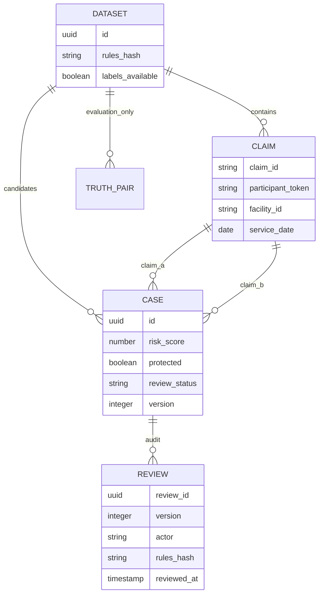
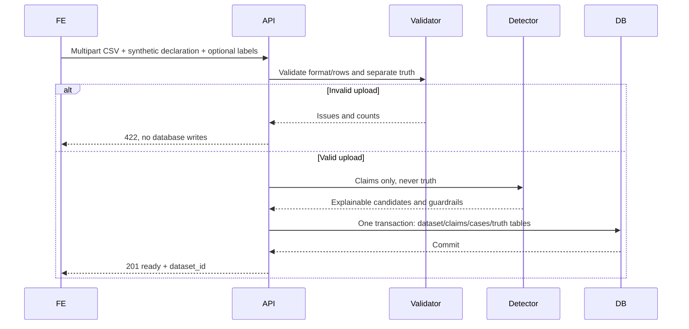
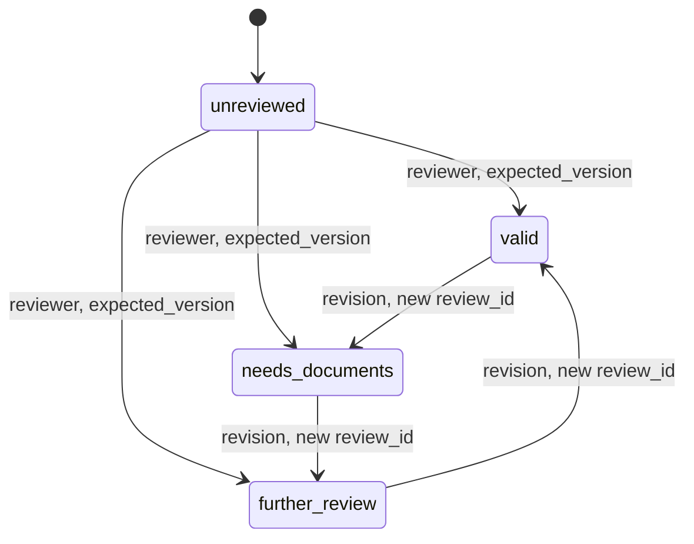

ERD ini menunjukkan truth terpisah dari input detector dan review audit append-only.

Diagram upload membedakan loading UI dari transaksi server yang sinkron.

State diagram review menunjukkan revision guard, bukan keputusan pembayaran.

Semua pasangan status akhir boleh direvisi, bukan hanya tiga panah contoh. Setiap transisi menambah audit. Payload retry identik tidak menambah audit; stale version ditolak. Membuka detail bukan transisi state DB.
